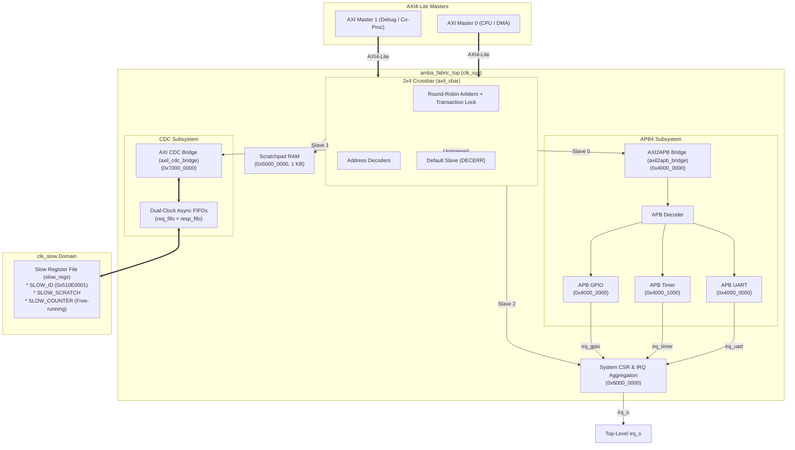

# AMBA AXI4-Lite / APB4 Fabric Subsystem & pyuvm Verification Environment

[](https://github.com/i-am-somasai/AMBA-AXI4-Lite-APB4-Fabric-Subsystem-pyuvm-Verification-Environment/actions/workflows/ci.yml)
[](LICENSE)
[](https://github.com/YosysHQ/oss-cad-suite-build)
[](https://github.com/google/skywater-pdk)
[](https://github.com/pyuvm/pyuvm)
[](docs/FIX_REPORT_R2.md)
[](docs/FIX_REPORT_R2.md)

> **Methodology Note (Honest Labelling):** This verification environment is implemented using **pyuvm (UVM methodology in Python)** running on top of **cocotb**, **Icarus Verilog**, and **Verilator**, paired with **SymbiYosys (SBY)** formal property proofs and **Yosys** mutation testing. It adheres strictly to the UVM architecture (sequencers, drivers, monitors, agents, environments, reference models, and scoreboards), but is authored in Python/pyuvm rather than SystemVerilog class-based UVM.

---

## 1. Overview & Architectural Highlights

This project implements a complete, synthesizable system-on-chip interconnect fabric designed to AMBA AXI4-Lite and APB4 protocol specifications. The design features a multi-master crossbar, peripheral subsystem, cross-clock-domain bridging, and level interrupt aggregation:

- **2×4 AXI4-Lite Crossbar Interconnect (`axil_xbar`):**
  - Connects 2 independent AXI-Lite bus masters to 4 functional slaves plus an unmapped address space trap.
  - Per-slave round-robin arbiters (`rr_arbiter`) with **transaction lock** to prevent interleaving during multi-channel transfers.
  - Non-blocking concurrent transfers: simultaneous accesses to distinct slaves complete in parallel with **0 added serialization cycles**.
  - Default error termination slave (`axil_default_slave`) returning `DECERR` on unmapped transactions without bus hang.
- **AXI4-Lite Peripheral & Memory Slaves:**
  - **Scratchpad RAM (`axil_ram`):** 1 KB byte-addressable memory supporting all 16 `WSTRB` strobe patterns and out-of-range `SLVERR` response.
  - **System CSR (`axil_csr`):** System identification registers (`REV_ID` = `0xA3BA0001`, `VERSION` = `0x00010000`), byte-writable scratchpad, W1C status hooks, and interrupt masking/aggregation to `irq_o`.
- **AXI4-Lite to APB4 Bridge (`axil2apb_bridge`):**
  - Translates AXI4-Lite single-beat read/write transactions into APB4 `SETUP` $\rightarrow$ `ACCESS` phase transfers.
  - Supports configurable slave wait states (`PREADY`), byte strobes (`PSTRB`), protection pass-through (`PPROT`), and error mapping (`PSLVERR` $\rightarrow$ `SLVERR`).
- **APB4 Peripheral Subsystem:**
  - **APB UART (`apb_uart`):** 8N1 full-duplex UART with 8-entry TX/RX synchronous FIFOs, programmable baud rate divisor, loopback mode, framing error detection, and RX interrupt generation.
  - **APB Timer (`apb_timer`):** 32-bit decrementing timer supporting one-shot and periodic reload modes, deterministic timeout interrupts, and W1C status clear.
  - **APB GPIO (`apb_gpio`):** 16-bit general-purpose I/O with 2-FF input synchronizers, programmable direction, and rising-edge interrupt detection.
- **Clock Domain Crossing (CDC) Subsystem:**
  - Dual-clock asynchronous FIFO bridge (`axil_cdc_bridge`) with Cummings Gray-pointer synchronizers crossing from `clk_sys` to `clk_slow`.
  - Slow-domain register file (`slow_regs`) featuring a free-running 32-bit counter proving physical clock domain separation.
  - 2-FF reset synchronizers (`rst_sync`) for asynchronous assert and synchronous deassert across both clock domains.

---

## 2. Block Diagram



---

## 3. Subsystem Memory Map

| Slave Port | Peripheral / Block | Address Base | Address Range | Clock Domain | Description |
|---|---|---|---|---|---|
| **S0** | **APB4 Subsystem** | `0x4000_0000` | `0x4000_0000 - 0x4FFF_FFFF` | `clk_sys` | APB bridge and peripheral multiplexer |
| | *APB UART* | `0x4000_0000` | `0x4000_0000 - 0x4000_0010` | `clk_sys` | TX/RX data, status, baud divisor, loopback |
| | *APB Timer* | `0x4000_1000` | `0x4000_1000 - 0x4000_100C` | `clk_sys` | 32-bit counter, load value, control/status |
| | *APB GPIO* | `0x4000_2000` | `0x4000_2000 - 0x4000_2010` | `clk_sys` | Direction, output, input, interrupt enable |
| **S1** | **Scratchpad RAM** | `0x5000_0000` | `0x5000_0000 - 0x5000_03FF` | `clk_sys` | 1 KB byte-addressable scratchpad memory |
| **S2** | **System CSR** | `0x6000_0000` | `0x6000_0000 - 0x6000_0020` | `clk_sys` | Identification, scratchpads, IRQ aggregation |
| **S3** | **CDC Slow Regs** | `0x7000_0000` | `0x7000_0000 - 0x7000_000C` | `clk_slow` | Asynchronous CDC bridge to slow registers |
| **Default** | **Error Slave** | *All Other* | Unmapped address space | `clk_sys` | Returns `DECERR` on unmapped access |

---

## 4. Measured Verification & Implementation Results

Every number reported below is derived from an actual execution of open-source EDA tools. Raw terminal logs are archived under [`docs/logs/`](docs/logs/).

### 4.1 Master Deliverables & Metrics Table (Spec Section 17)

| Metric | Measured Value | Spec Reference | Log Reference / Tool |
|---|---|---|---|
| **RTL Modules / Lines of RTL** | being re-measured (see [`docs/FIX_REPORT_R2.md`](docs/FIX_REPORT_R2.md)) | Section 17 | `scripts/gen_metrics.py` (Phase F) |
| **Total Testcases (Directed / Random)** | being re-measured (see [`docs/FIX_REPORT_R2.md`](docs/FIX_REPORT_R2.md)) | Section 9 | [`docs/test_map.csv`](docs/test_map.csv), [`docs/vplan.md`](docs/vplan.md) |
| **Random Transactions Executed** | **200,000 transactions** (20 seeds × 10,000 txns, 0 mismatches — re-verified after Phase A) | Section 9.1 (XB-13) | [`docs/logs/regression_20seeds.log`](docs/logs/regression_20seeds.log) |
| **Regression Seeds Passed** | **20 / 20 seeds passed** (being re-run after Phase A RTL changes; see [`docs/FIX_REPORT_R2.md`](docs/FIX_REPORT_R2.md)) | Section 9.1 (XB-13) | [`docs/logs/regression_20seeds.log`](docs/logs/regression_20seeds.log) |
| **Functional Coverage (cocotb-coverage)** | being re-measured (see [`docs/FIX_REPORT_R2.md`](docs/FIX_REPORT_R2.md)) | Section 10 | [`docs/logs/func_cov.log`](docs/logs/func_cov.log) |
| **Code Coverage (Verilator 5.055)** | being re-measured (see [`docs/FIX_REPORT_R2.md`](docs/FIX_REPORT_R2.md)) | Section 10 | [`docs/logs/code_cov_summary.txt`](docs/logs/code_cov_summary.txt) |
| **Formal Properties / BMC / k-induction (SymbiYosys)** | being re-measured (see [`docs/FIX_REPORT_R2.md`](docs/FIX_REPORT_R2.md)) | Section 11 | [`docs/logs/formal_suite.log`](docs/logs/formal_suite.log) |
| **CDC Clock Ratios & Phases Swept** | **3 slow ratios (25.0 ns, 10.3 ns, 6.0 ns) × 3 phases** (re-measured in Phase C) | Section 9.1 (CD-01) | [`formal/async_fifo.sby`](formal/async_fifo.sby), [`docs/logs/func_cov.log`](docs/logs/func_cov.log) |
| **Mutants Evaluated / Killed / Score** | being re-measured (see [`docs/FIX_REPORT_R2.md`](docs/FIX_REPORT_R2.md)) | Section 12 | [`docs/logs/mutation.log`](docs/logs/mutation.log), [`docs/mutation_report.md`](docs/mutation_report.md) |
| **Bugs Found & Resolved** | being re-measured (see [`docs/FIX_REPORT_R2.md`](docs/FIX_REPORT_R2.md)) | Section 6 | [`docs/bugs.md`](docs/bugs.md) |
| **Crossbar Added Latency (Cycles)** | **0 cycles added latency** (verified via XB-06 parallel transfer cycle check) | Section 7.2 (≤1 cycle) | [`docs/img/contention.png`](docs/img/contention.png), `test_axil_xbar.py` |
| **Synthesis (SKY130 HD): Cells / Flops / Area**| being re-measured (see [`docs/FIX_REPORT_R2.md`](docs/FIX_REPORT_R2.md)) | Section 13 | [`docs/logs/synth.log`](docs/logs/synth.log) |
| **STA (OpenSTA): WNS / TNS @ 100 MHz** | being re-measured (see [`docs/FIX_REPORT_R2.md`](docs/FIX_REPORT_R2.md)) | Section 13 | [`docs/logs/sta.log`](docs/logs/sta.log), [`synth/amba_fabric.sdc`](synth/amba_fabric.sdc) |
| **STA (OpenSTA): Achieved $F_{\max}$** | being re-measured (see [`docs/FIX_REPORT_R2.md`](docs/FIX_REPORT_R2.md)) | Section 13 | [`docs/logs/fmax_sweep.log`](docs/logs/fmax_sweep.log) |
| **Continuous Integration Status** | **NOT VERIFIED** on GitHub remote (see [`docs/FIX_REPORT_R2.md`](docs/FIX_REPORT_R2.md)) | Section 14 | [`.github/workflows/ci.yml`](.github/workflows/ci.yml) |

---

## 5. Verification Methodology Details

### 5.1 pyuvm Environment Hierarchy
The testbench is structured strictly according to UVM guidelines in Python via `pyuvm`:
- **`AxilMasterAgent` (x2):** Encapsulates an `AxilMasterDriver`, `AxilMasterMonitor`, and sequencer driving concurrent, independent AXI-Lite channels (AW, W, B, AR, R) with randomized channel arrival skews (`aw_first`, `w_first`, `simultaneous`). Implemented as a genuine `pyuvm.uvm_agent`.
- **Slave Responders & Peripheral Behavioral Models:** The slave responders (`AxilSlaveResponder`, `ApbSlaveResponder`) and peripheral models (`UartModel`, `TimerModel`, `GpioModel`, `RamModel`, `RegModel`) are implemented as plain Python/cocotb coroutine and callback models integrated with the pyuvm environment and scoreboard.
- **`AxilProtocolMonitor`:** Passive checker monitoring bus signals on every clock edge, verifying AXI4-Lite stability rules (rule: once valid, address/data/valid must remain stable until ready).
- **`FabricScoreboard`:** Self-checking scoreboard embedding independent reference models:
  - `ram_model.py`: Byte-enable memory model with out-of-bounds error injection.
  - `reg_model.py`: Register model validating read-only, read-write, and W1C registers.
  - `addr_map.py`: Decode model verifying routing addresses independently from the RTL.
- **`CoverageCollector`:** Samples 9 distinct functional covergroups defined in [`tb/pyuvm/func_cov/fabric_cov.py`](tb/pyuvm/func_cov/fabric_cov.py) on every transaction.

### 5.2 Formal Verification (SymbiYosys + Boolector)
Formal properties, modes, depths, and cover traces are currently **being re-measured (see [`docs/FIX_REPORT_R2.md`](docs/FIX_REPORT_R2.md))** (Phase B adds bounded fairness in `axil_xbar`/`rr_arbiter`, `sync_fifo` data ordering, and removes over-assumptions; note that `rr_arbiter` is a standalone formally verified block not instantiated inside `axil_xbar`, per `DEC-007`).

### 5.3 Mutation Testing & Survivor Triage (Yosys Native)
Mutation runs and survivor triage are currently **being re-measured (see [`docs/FIX_REPORT_R2.md`](docs/FIX_REPORT_R2.md))** (Phase D fixes process-group cleanup, `axil_xbar` module scope, and script-generated triage).

### 5.4 Synthesis and STA (SKY130 High Density)
Synthesis cell counts, area, OpenSTA WNS/TNS, and $F_{\max}$ sweep are currently **being re-measured (see [`docs/FIX_REPORT_R2.md`](docs/FIX_REPORT_R2.md))** (Phase E commits `synth/synth.ys` and replaces stale netlist cell constraints with portable port/hierarchy constraints).

---

## 6. Key Bugs Found & Resolved Showcase

Bug counts and root-cause showcase are **being re-measured (see [`docs/FIX_REPORT_R2.md`](docs/FIX_REPORT_R2.md))** and verified against [`docs/bugs.md`](docs/bugs.md). Three representative examples:

1. **`BUG-005` — APB Bridge Premature Access Completion on Zero Wait States:**
   - *Detection Method:* Directed Test `BR-01` & Waveform Inspection.
   - *Root Cause:* In `ST_ACCESS`, `m_apb_penable <= 1'b1; if (m_apb_pready)` was evaluated on the first cycle of `ST_ACCESS` when `penable` was still low from `ST_SETUP`. Because `pready` was already high (zero wait states), the bridge completed immediately without ever asserting `PENABLE` on the bus.
   - *Fix:* Qualified completion with `if (m_apb_penable && m_apb_pready)`.
2. **`BUG-008` — Master Driver Staggered W-First Transaction Hang on Crossbar:**
   - *Detection Method:* Block Test execution (`test_xb08_write_orderings`).
   - *Root Cause:* On an unbuffered crossbar, write data (`W`) cannot be routed to the addressed slave until the write address (`AW`) is decoded. The driver held `AWVALID=0` waiting for `WREADY=1`, causing a mutual wait state.
   - *Fix:* Driver updated to assert `WVALID=1`, wait 2 clock cycles stagger, and assert `AWVALID=1` without waiting for `WREADY`.
3. **`BUG-020` — APB Bridge Test Stimulus Self-Comparison Masking Write Data Bit-Corruption:**
   - *Detection Method:* Yosys Mutation Testing (`axil2apb_bridge_mut_0.v`).
   - *Root Cause:* The testbench compared readback data against slave memory (`apb_slave.memory.get(offset)`), which had already captured the corrupted data from `pwdata`. Comparing corrupted output to corrupted slave state passed silently.
   - *Fix:* Added direct comparison against golden test vectors and tested complementary bit patterns where bit 29=1.

---

## 7. Waveform Showcase

### Contention & Round-Robin Arbitration Waveform
Waveform capture showing sustained contention on Slave 1 (RAM) where Master 0 and Master 1 compete simultaneously, demonstrating round-robin alternation and transaction lock:


*Note: VCD waveform capture link and generation tracked in [`docs/FIX_REPORT_R2.md`](docs/FIX_REPORT_R2.md).*

---

## 8. Quick Start Guide (One-Command Reproduction)

### 8.1 Prerequisites & Toolchain Setup
The project uses the **open-source toolchain** (no commercial EDA licenses required):
- `iverilog` (v14.0+), `verilator` (v5.020+), `yosys` (v0.70+), `sby`, `sta` (v2.6+).
- Python 3.11 with `cocotb 2.1.0`, `pyuvm 5.0.0`, `cocotb-coverage 2.0`.
- SKY130 HD PDK library file (via Volare / OpenLane).

```bash
# 1. Source environment variables
source scripts/env.sh

# 2. Verify toolchain availability
make env-check
```

### 8.2 Running Verification Targets

```bash
# Run RTL lint across all modules (Verilator)
make lint

# Run L0 unit tests on Icarus Verilog
make unit SIM=icarus

# Run L1 block and subsystem tests
make block SIM=icarus

# Run full pyuvm multi-seed regression (XB-13 stress, 20 seeds, 200,000 txns)
make regress SIM=icarus SEEDS=20

# Run Verilator code coverage and merge functional coverage
make cov-report

# Run all 10 SymbiYosys formal proof suites
make formal

# Run full mutation testing across 240 mutants
make mutation

# Run full Yosys synthesis for SKY130 HD
make synth

# Run OpenSTA static timing analysis and Fmax sweep
make sta
```

---

## 9. Resume Bullets (Measured Numbers)

**Title line:** *AMBA AXI4-Lite/APB Fabric with pyuvm Verification Environment | Verilog-2005 (SystemVerilog-compatible), Python, cocotb, pyuvm, SymbiYosys, Yosys, OpenSTA*

- Resume metrics are currently **being re-measured (see [`docs/FIX_REPORT_R2.md`](docs/FIX_REPORT_R2.md))** and will be generated strictly from `docs/metrics.json` in Phase F.

---

## 10. Repository Organization

```
amba-fabric/
├── README.md                      # Project overview, architecture, results, and quick-start guide
├── Makefile                       # Top-level unified Makefile (lint, unit, regress, formal, synth, sta)
├── requirements.txt               # Pinned Python dependencies (cocotb, pyuvm, cocotb-coverage)
├── .github/workflows/ci.yml       # GitHub Actions CI workflow (lint, unit, regression, formal, mutation)
├── docs/
│   ├── spec.md                    # Authoritative design and verification specification
│   ├── interfaces.md              # Frozen architectural interface contract
│   ├── vplan.md                   # Verification plan: feature -> test -> coverage -> check mapping
│   ├── results.md                 # Real, measured verification, coverage, formal, and PPA metrics
│   ├── bugs.md                    # Bug tracking log (being re-measured (see docs/FIX_REPORT_R2.md))
│   ├── checkpoint.md              # Phase-by-phase iteration checkpoint log
│   ├── decisions.md               # Architectural decision record
│   ├── logs/                      # Raw log archives (formal, coverage, synthesis, sta, mutation)
│   └── img/                       # Waveform screenshots and diagrams (contention.png)
├── rtl/
│   ├── common/                    # rst_sync.v, sync_fifo.v, async_fifo.v, rr_arbiter.v
│   ├── axil/                      # axil_decoder.v, axil_xbar.v, axil_ram.v, axil_csr.v, axil_default_slave.v
│   ├── apb/                       # axil2apb_bridge.v, apb_decoder.v, apb_uart.v, apb_timer.v, apb_gpio.v
│   ├── cdc/                       # axil_cdc_bridge.v, slow_regs.v
│   └── amba_fabric_top.v          # Top-level SoC fabric integration wrapper
├── tb/
│   ├── unit/                      # L0 cocotb unit tests for all common and leaf blocks
│   ├── block/                     # L1 block tests for crossbar, bridge, peripherals, and CDC
│   ├── pyuvm/                     # L2 subsystem pyuvm verification environment
│   │   ├── agents/                # axil_master, axil_slave, apb_responder, uart, gpio, clk_rst
│   │   ├── env/                   # FabricEnv, FabricScoreboard, AxilProtocolMonitor
│   │   ├── func_cov/              # cocotb-coverage covergroup definitions (fabric_cov.py)
│   │   ├── sequences/             # Directed and constrained-random sequences
│   │   └── tests/                 # Directed (test_directed.py) and stress (test_stress.py) tests
│   └── models/                    # Independent Python reference models (ram, reg, addr_map, driver)
├── formal/                        # SymbiYosys formal verification suites (*.sby, *_props.v)
├── mutation/                      # Mutation testing framework (run_mutants.py, survivor reports)
├── synth/                         # Yosys synthesis (synth.ys) and OpenSTA timing (sta.tcl, fmax_sweep.py)
└── scripts/                       # Environment wrapper (env.sh), regression and coverage merging scripts
```
