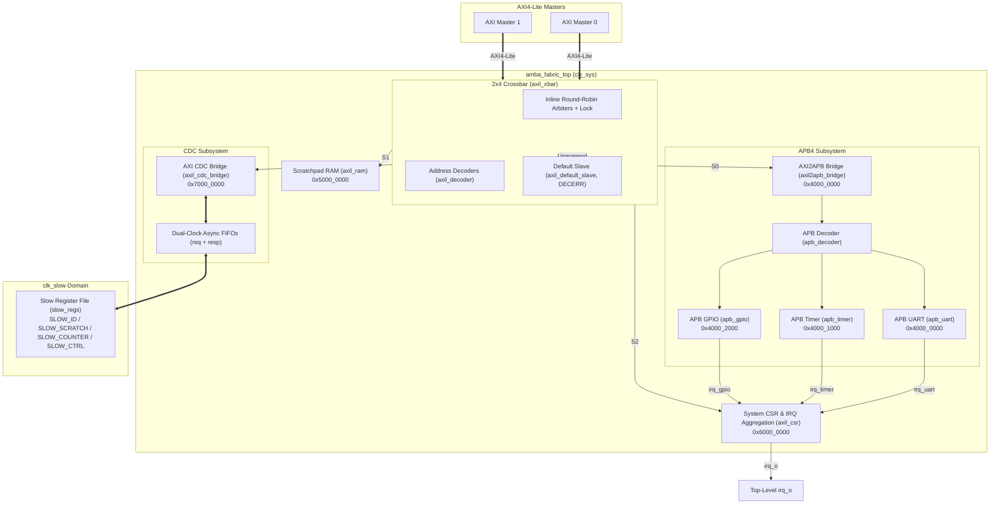

# AMBA AXI4-Lite / APB4 Fabric & pyuvm Verification Environment

## 1. Overview

This repository contains a synthesizable Verilog-2005 AMBA AXI4-Lite and APB4 SoC peripheral fabric together with a multi-level open-source verification environment built around `cocotb`, `pyuvm`, `SymbiYosys`, `Yosys`, and `OpenSTA`. It is aimed at RTL and DV engineers studying or building multi-master AXI4-Lite interconnects, APB peripheral bridges, dual-clock CDC register interfaces, and reproducible open-source verification flows (Icarus Verilog, Verilator, Boolector, ABC, and SKY130 HD synthesis/STA).

---

## 2. What This Project Is About

- **AXI4-Lite and APB4:** AXI4-Lite is a simple, five-channel (`AW`, `W`, `B`, `AR`, `R`), single-beat memory-mapped bus where address (`AW`) and write data (`W`) arrive on independent handshake channels (`VALID`/`READY`). APB4 is a simpler two-phase (`SETUP` then `ACCESS`) peripheral bus suited for low-bandwidth registers such as UARTs, timers, and GPIOs.
- **Crossbar interconnect:** A `2×4` crossbar (`axil_xbar`) lets two masters (for example, a CPU and a DMA engine) access four slave regions concurrently when they target different slaves, while arbitrating fairly and locking transactions when both masters contend for the same slave. Unmapped addresses are routed to a default error slave returning `DECERR`.
- **Why a second clock domain (CDC) matters:** In real SoCs, slow always-on or peripheral registers often run on a separate, asynchronous clock (`clk_slow`) from the main bus clock (`clk_sys`). Sampling signals directly across asynchronous clocks causes metastability and corrupts multi-bit buses, so `axil_cdc_bridge` bridges transactions safely across clock domains using dual-clock Gray-pointer asynchronous FIFOs (`async_fifo`) and dedicated reset synchronizers (`rst_sync`).
- **Why verification is the centerpiece:** Writing bus RTL is only half the engineering problem; subtle protocol corner cases (out-of-order `W`-before-`AW` arrival, wait-state backpressure, cross-domain resets, and word-alignment rules) break silently without rigorous checking. Accordingly, the project invests primarily in L0 unit tests, L1 block tests, an L2 `pyuvm` constrained-random scoreboard environment, passive monitor-only functional coverage, formal property proofs, mutation testing, and independent adversarial audits.

---

## 3. Status

<!-- BEGIN:metrics:readme_badges -->
[](https://github.com/i-am-somasai/AMBA-AXI4-Lite-APB4-Fabric-Subsystem-pyuvm-Verification-Environment/actions/workflows/ci.yml)
[](https://github.com/i-am-somasai/AMBA-AXI4-Lite-APB4-Fabric-Subsystem-pyuvm-Verification-Environment/actions/runs/45761725094)
[](LICENSE)
[](https://github.com/YosysHQ/oss-cad-suite-build)
[](https://github.com/google/skywater-pdk)
[](https://github.com/pyuvm/pyuvm)
[](docs/logs/func_cov.log)
[](docs/logs/formal_suite.log)
<!-- END:metrics:readme_badges -->

- **Continuous Integration (`.github/workflows/ci.yml`):** Automated CI runs on `main`, `phase-*`, `remediation-*`, and `release-*` branches using `YosysHQ/setup-oss-cad-suite@v3` (`2026-11-22`). CI executes `check_no_synthetic_cov.sh`, `check_bug_refs.py`, `check_docs_consistency.py`, `make lint`, L0 unit tests, L1 block tests, 3-seed Icarus regression, the committed sanity-mutant gate, all SymbiYosys formal suites, and the 24-mutant sampled mutation smoke test, then uploads built XML/formal logs. SKY130 synthesis/STA, full 20-seed Verilator coverage (`make cov-report`), and the full 240-mutant run execute locally (see the CI row in Section 6 for the recorded run URL, commit SHA, and duration).
- **Independent Audit Verdict:** **`READY WITH MINOR ISSUES`** (`0` BLOCKER, `0` MAJOR, `15` MINOR) from the Audit 3 Closure verification on pushed commit `4bd08534f3a7ebb5f99c3322843b2703eab7ac96`. Full audit reports, machine-readable CSV/JSON tables, and SHA-256 checksums are archived in [`docs/audits/`](docs/audits/README.md).

---

## 4. Architecture

### 4.1 Block Diagram



### 4.2 Top-Level Parameters (`amba_fabric_top`)

| Parameter | Default | Description |
|---|---:|---|
| `DATA_WIDTH` | `32` | AXI4-Lite and APB4 data bus width |
| `ADDR_WIDTH` | `32` | System address width |
| `STRB_WIDTH` | `DATA_WIDTH / 8` (`4`) | Byte write-strobe width |
| `RAM_DEPTH` | `256` (`64` in SKY130 synth) | Number of 32-bit words in `axil_ram` |
| `GPIO_WIDTH` | `16` | Width of `gpio_i`, `gpio_o`, and `gpio_dir` |

Sub-instance topology on `amba_fabric_top` pins `NUM_MASTERS = 2`, `NUM_SLAVES = 4` on `u_xbar`, and `FIFO_DEPTH = 4` on `u_cdc_bridge` (`DEC-015`). Full port/register contracts live in [`docs/interfaces.md`](docs/interfaces.md).

### 4.3 Memory Map (Generated from `rtl/axil/axil_decoder.v`)

<!-- BEGIN:metrics:readme_memory_map -->
| Slave Port | Peripheral / Block | Address Base | Decoded Slot Range (Size) | Clock Domain | Description |
|---|---|---|---|---|---|
| **S0** | **APB4 Subsystem** | `0x4000_0000` | `0x4000_0000 - 0x4000_FFFF` (64 KB) | `clk_sys` | APB bridge and peripheral multiplexer (`rtl/axil/axil_decoder.v`) |
| | *APB UART* | `0x4000_0000` | `0x4000_0000 - 0x4000_0010` (`4 KB` sub-slot `0x4000_0000 - 0x4000_0FFF`) | `clk_sys` | TX/RX data, status, baud divisor, loopback |
| | *APB Timer* | `0x4000_1000` | `0x4000_1000 - 0x4000_100C` (`4 KB` sub-slot `0x4000_1000 - 0x4000_1FFF`) | `clk_sys` | 32-bit counter, load value, control/status |
| | *APB GPIO* | `0x4000_2000` | `0x4000_2000 - 0x4000_2010` (`4 KB` sub-slot `0x4000_2000 - 0x4000_2FFF`) | `clk_sys` | Direction, output, input, interrupt enable |
| **S1** | **Scratchpad RAM** | `0x5000_0000` | `0x5000_0000 - 0x5000_0FFF` (4 KB slot; `0x5000_0000 - 0x5000_03FF` = `1 KB` RAM) | `clk_sys` | Byte-addressable scratchpad; offset `>= 0x400` returns `SLVERR` |
| **S2** | **System CSR** | `0x6000_0000` | `0x6000_0000 - 0x6000_00FF` (256 B slot; `0x6000_0000 - 0x6000_0020` active regs) | `clk_sys` | Identification, scratchpads, IRQ aggregation |
| **S3** | **CDC Slow Regs** | `0x7000_0000` | `0x7000_0000 - 0x7000_00FF` (256 B slot; `0x7000_0000 - 0x7000_000C` active regs) | `clk_slow` | Asynchronous CDC bridge to slow registers |
| **Default** | **Error Slave** | *All Other* | Unmapped address space | `clk_sys` | Returns `DECERR` on unmapped access |
<!-- END:metrics:readme_memory_map -->

### 4.4 Clock and Reset Scheme

- **Clocks:** `clk_sys` drives the AXI4-Lite crossbar, `axil_ram`, `axil_csr`, `axil2apb_bridge`, and the APB4 peripherals (`apb_uart`, `apb_timer`, `apb_gpio`). `clk_slow` is an asynchronous clock driving `slow_regs` and the slow side of `axil_cdc_bridge`.
- **Resets:** Active-low external `rst_n` passes through separate 2-FF `rst_sync` modules for `clk_sys` (`rst_sys_n`) and `clk_slow` (`rst_slow_n`), asserting asynchronously and deasserting synchronously. Inside `axil_cdc_bridge`, cross-domain reset synchronizers coordinate `both_rst_n = rst_sys_n & rst_slow_n` so an independent reset on either domain flushes both async FIFOs cleanly and aborts any in-flight `clk_sys` transaction with `SLVERR` instead of deadlocking (`DEC-008`, `BUG-024`).

### 4.5 RTL Module Inventory

| Domain | Modules |
|---|---|
| `rtl/` | `amba_fabric_top.v` (top-level integration) |
| `rtl/common/` | `rst_sync.v` (2-FF reset sync), `sync_fifo.v` (single-clock FIFO), `async_fifo.v` (Gray-pointer CDC FIFO), `rr_arbiter.v` (standalone library arbiter, `DEC-007`) |
| `rtl/axil/` | `axil_decoder.v` (one-hot address decoder), `axil_default_slave.v` (`DECERR` slave inside `axil_xbar`, `DEC-014`), `axil_xbar.v` (`2×4` crossbar with inline round-robin lock), `axil_ram.v` (scratchpad RAM), `axil_csr.v` (CSR + IRQ aggregation) |
| `rtl/apb/` | `axil2apb_bridge.v` (AXI4-Lite to APB4 bridge), `apb_decoder.v` (APB slot decode), `apb_uart.v` (8N1 UART, 8-entry TX/RX FIFOs), `apb_timer.v` (32-bit timer), `apb_gpio.v` (16-bit GPIO with 2-FF input sync) |
| `rtl/cdc/` | `axil_cdc_bridge.v` (dual-FIFO CDC bridge), `slow_regs.v` (`clk_slow` registers + free-running counter) |

### 4.6 Unimplemented Stretch Features

Per [`docs/spec.md`](docs/spec.md), the following P2 stretch items are **not** implemented:
- `S-02`: Gate-level simulation of the synthesized netlist
- `S-03`: OpenLane physical place-and-route / GDSII closure
- `X-01`: RISC-V core attached as a third AXI master
- `X-02`: Multiple outstanding AXI4 transactions with response FIFOs

---

## 5. Verification Approach

- **Three Simulation Levels:**
  - **L0 Unit (`tb/unit/`):** Standalone `cocotb` tests for `rst_sync`, `sync_fifo`, `async_fifo`, `rr_arbiter`, `axil_decoder`, `axil_default_slave`, `axil_ram`, and `axil_csr`.
  - **L1 Block (`tb/block/`):** Subsystem/block `cocotb` tests for `axil_xbar`, `axil2apb_bridge`, `apb_uart`, `apb_timer`, `apb_gpio`, `axil_cdc_bridge`, and top-level integration checks (`test_amba_fabric_top.py`).
  - **L2 Top Subsystem (`tb/pyuvm/`):** `FabricEnv` integrates two genuine `pyuvm.uvm_agent` master agents (`AxilMasterAgent` with sequencer, driver, and monitor), sequences (`directed_seqs.py`, `coverage_closure_seq.py`, `fabric_stress_seq.py`), and `FabricScoreboard` backed by independent reference models (`tb/models/`). Slave responders (`AxilSlaveResponder`, `ApbSlaveResponder`) and peripheral behavioral models are plain `cocotb` Python classes (`DEC-005`), not `uvm_agent` hierarchies.
- **Monitor-Only Functional Coverage:** All 9 covergroups in [`tb/pyuvm/func_cov/fabric_cov.py`](tb/pyuvm/func_cov/fabric_cov.py) are sampled exclusively from passive hardware monitors (`tb/pyuvm/monitors/fabric_monitors.py`) observing live DUT pins (`AxilBusMonitor`, `CrossbarContentionMonitor`, `ApbBusMonitor`, `CdcMonitor`, `UartActivityMonitor`, `ResetPhaseMonitor`). Sequences never call `sample_*`, enforced automatically by [`scripts/check_no_synthetic_cov.sh`](scripts/check_no_synthetic_cov.sh) inside `make lint`.
- **Formal Verification (`formal/`):** 10 SymbiYosys suites verify protocol stability, causality, FIFO data integrity (`(* anyconst *)` magic value), arbiter bounded fairness, timer countdown, and bridge/crossbar invariants. Unbounded proofs (`k-induction (prove)` via `smtbmc boolector` and `PDR (prove)` via `abc pdr`) are distinguished explicitly from `prv+bmc` (`DEC-006`) and bounded `BMC depth N` runs; see [`docs/limitations.md`](docs/limitations.md).
- **Mutation Testing & Equivalence Triage (`mutation/`):** Evaluated against a frozen 240-mutant list ([`mutation/mutant_list_240.json`](mutation/mutant_list_240.json), 30 mutants per module across 8 modules, seed 42). Raw mutation score (`killed / valid`) is reported alongside adjusted scores that exclude only survivors proved equivalent by unbounded Yosys `equiv_induct`, unbounded SymbiYosys `mode prove` (`abc pdr`), or structural dead-wire proofs (`u_default_slave._unused_inputs`), via [`mutation/check_equiv.py`](mutation/check_equiv.py). Timeouts and build errors are never counted as kills.
- **Sanity-Mutant Gate (`mutation/sanity/run_sanity.py`):** Injects 17 targeted RTL bugs (`SMUT-01`–`SMUT-17`), verifies each compiles cleanly under `iverilog` and `verilator --lint-only`, and asserts that its target test fails with an explicit assertion.
- **Independent Audits:** Every phase was checked by external adversarial audits archived under [`docs/audits/`](docs/audits/README.md).

---

## 6. Results

Every metric below is regenerated automatically from [`docs/metrics.json`](docs/metrics.json) via [`scripts/gen_docs.py`](scripts/gen_docs.py) (`docs/results.md` contains the expanded breakdown tables).

### 6.1 Summary Metrics

<!-- BEGIN:metrics:readme_metrics_table -->
| Metric | Measured Value | Spec Reference | Log Reference / Tool |
|---|---|---|---|
| **RTL Modules / Lines of RTL** | **17 modules / 3,200 lines** (non-blank, non-comment) | Section 17 | [`docs/metrics.json`](docs/metrics.json) |
| **Test Definitions / XML Runs / Spec Map** | **61 Python tests / 96 XML runs (96 PASS, 0 FAIL) / 40/40 Spec IDs** | Section 9 | [`docs/test_map.csv`](docs/test_map.csv), [`docs/vplan.md`](docs/vplan.md) |
| **Random Transactions Executed** | **200,000 transactions** (20 Verilator seeds `1..20` × 10,000 txns, 0 mismatches; plus 20 Icarus seeds `601..620` = 200,000 txns) | Section 9.1 (XB-13) | [`docs/logs/phase_c_cov_report.log`](docs/logs/phase_c_cov_report.log), [`docs/logs/regression_20seeds.log`](docs/logs/regression_20seeds.log) |
| **Functional Coverage (cocotb-coverage)** | **100.00% (267/267 reachable bins)** across 24 merged YAMLs; 36 waived illegal/contradictory bins | Section 10 | [`docs/logs/func_cov.log`](docs/logs/func_cov.log), [`docs/coverage_waivers.md`](docs/coverage_waivers.md) |
| **Code Coverage (Verilator)** | **Line 92.4% (496/537) \| Branch 91.6% (501/547) \| Expr 93.8% (1036/1105) \| Toggle 76.2% (10821/14202) \| FSM State 100.0% (5/5)** | Section 10 | [`docs/logs/code_cov_summary.txt`](docs/logs/code_cov_summary.txt) |
| **Formal Verification (SymbiYosys + Boolector / ABC)** | **10/10 suites PASS** (3 `k-induction (prove)`, 1 `PDR (prove)`, 1 `k-induction (prove) + BMC depth 20`, 5 `BMC depth 20..30`; 84 cover traces reached in 152s) | Section 11 | [`docs/logs/formal_suite.log`](docs/logs/formal_suite.log) |
| **CDC Clock Ratios & Phases Swept** | **3 slow periods (25.0 ns, 10.3 ns, 6.0 ns) × 3 phases**; formal `async_fifo` BMC depth 25 & `axil_cdc_bridge` BMC depth 30 | Section 9.1 (CD-01) | [`formal/async_fifo.sby`](formal/async_fifo.sby), [`docs/logs/func_cov.log`](docs/logs/func_cov.log) |
| **Mutation Testing (Yosys `mutate`)** | **Baseline 165/240 (68.75%) → Final 219/240 (91.25% raw)**, 0 timeouts, 0 build errors; **17 unbounded-proven/dead equivalent** (14 `equiv_induct`/SBY `prove` + 3 dead-signal), **0 bounded-equivalent (depth 10)**, **4 residual**; **Conservative Adj. 98.21% (219/223)**; Bounded-Incl. Adj. 98.21% (219/223) | Section 12 | [`docs/logs/mutation.log`](docs/logs/mutation.log), [`docs/mutation_report.md`](docs/mutation_report.md) |
| **Bugs Found & Resolved** | **24 bugs (BUG-001–BUG-024)**: 15 RTL + 9 TB/formal/tooling | Section 6 | [`docs/bugs.md`](docs/bugs.md) |
| **Crossbar Added Latency (Cycles)** | **0 cycles added latency** (verified via XB-06 parallel transfer check) | Section 7.2 | [`docs/img/contention.png`](docs/img/contention.png), [`tb/block/test_axil_xbar.py`](tb/block/test_axil_xbar.py) |
| **Synthesis (SKY130 HD, `RAM_DEPTH=64`)** | **9,237 cells / 3,630 flops** (2,048 RAM flops) / **138,086.19 µm²** (74.78% sequential) | Section 13 | [`synth/synth.ys`](synth/synth.ys), [`docs/logs/synth.log`](docs/logs/synth.log) |
| **STA (OpenSTA): Target 100 MHz (10.0 ns)** | **VIOLATED: WNS -18.60 ns / TNS -54046.39 ns** (full timed netlist; pre-layout unbuffered `rst_sys_n`, fanout 958, slew 29.27 ns); **`clk_slow` MET (+16.64 ns)**, **Hold MET (+0.23 ns)**; datapath+I/O ref WNS -5.89 ns | Section 13 | [`docs/logs/sta.log`](docs/logs/sta.log), [`synth/amba_fabric.sdc`](synth/amba_fabric.sdc) |
| **STA (OpenSTA): Achieved $F_{\max}$** | **34.97 MHz (28.60 ns)** full pre-layout netlist; **62.89 MHz (15.90 ns)** datapath+I/O reference (`rst_sync` Q isolated in STA only) | Section 13 | [`docs/logs/fmax_sweep.log`](docs/logs/fmax_sweep.log) |
| **Continuous Integration Status** | **PASS** ([run `45761725094`](https://github.com/i-am-somasai/AMBA-AXI4-Lite-APB4-Fabric-Subsystem-pyuvm-Verification-Environment/actions/runs/45761725094), commit `292e06555af2307be4811ef4d1b61a9629cb6816`, `3m 50s`: Covers check_no_synthetic_cov, check_bug_refs, check_docs_consistency, Verilator lint, L0 unit, L1 block, 3-seed Icarus regress, 17 sanity mutants, 10/10 formal, 24-mutant sampled mutation smoke, and artifact upload; SKY130 synthesis/STA, full 20-seed coverage, and the full 240-mutant run are local only) | Section 14 | [`.github/workflows/ci.yml`](.github/workflows/ci.yml) |
| **Out-of-Scope Items (`S-02/S-03`, `X-01/X-02`)** | **N/A (out of scope)**: gate-level sim (`S-02`), OpenLane GDSII (`S-03`), RISC-V CPU (`X-01`), multi-outstanding AXI4 (`X-02`) | Section 1.4 / 13.5 | [`docs/spec.md`](docs/spec.md) |
<!-- END:metrics:readme_metrics_table -->

### 6.2 Formal Verification Summary

<!-- BEGIN:metrics:readme_formal_summary -->
All **10 SymbiYosys formal suites PASS** (`0` failures, **84 cover traces** reached across 152s total runtime, [`docs/logs/formal_suite.log`](docs/logs/formal_suite.log)):
- **Unbounded `k-induction (prove)` (`smtbmc boolector`):** `apb_timer` (`4` covers), `rr_arbiter` (`3` covers), `sync_fifo` (`8` covers).
- **Unbounded `PDR (prove)` (`abc pdr`):** `axil2apb_bridge` (`10` covers) (1-bit causality enforced directly in `formal/axil2apb_bridge_props.v`).
- **Hybrid (`prv+bmc`):** `axil_csr` (`k-induction (prove)` + `BMC depth 20`, `5` covers per `DEC-006`).
- **Bounded model checking (`BMC depth N`):** `apb_uart` (`BMC depth 25`, `9` covers), `async_fifo` (`BMC depth 25`, multiclock, `4` covers), `axil_cdc_bridge` (`BMC depth 30`, multiclock, `5` covers), `axil_ram` (`BMC depth 20`, `5` covers), `axil_xbar` (`BMC depth 20`, `31` covers) (bounded rationales documented in [`docs/limitations.md`](docs/limitations.md)).
- **Scope note (`DEC-007`):** `rr_arbiter` is a standalone formally verified and unit-tested library block and is not instantiated inside `axil_xbar` (which uses inline registered round-robin arbiters).
<!-- END:metrics:readme_formal_summary -->

### 6.3 Mutation Testing Summary

<!-- BEGIN:metrics:readme_mutation_summary -->
Evaluated on a frozen deterministic 240-mutant suite (`30` mutants per module across `8` RTL modules, seed `42`, [`mutation/mutant_list_240.json`](mutation/mutant_list_240.json)) using isolated process-group execution (`mutation/run_mutants.py`) and strict `$paramod*axil_xbar` module scoping ([`docs/mutation_report.md`](docs/mutation_report.md)):
- **Baseline (before gap tests):** `165/240` killed (**`68.75%` raw**), `64` survived, `11` timeouts, `0` build errors.
- **Final (same 240-mutant list):** **`219/240` killed (`91.25%` raw)**, **`0` timeouts**, **`0` build errors**.
- **Unbounded Equivalence & Adjusted Scores:** Of `21` survivors, **`17` are unbounded-proven equivalent or structurally dead** (`14` by Yosys `equiv_induct` / SymbiYosys `prove` `abc pdr` in [`docs/logs/mutation_equiv.log`](docs/logs/mutation_equiv.log) + `3` signal-level dead-wire proofs on `axil_default_slave._unused_inputs`), `0` remain `bounded-equivalent (depth 10)`, and **`4` are residual non-equivalent survivors**. **Conservative adjusted score (unbounded/dead only):** **`98.21%` (`219/223`)**; **Adjusted score including bounded-equivalent (depth 10):** **`98.21%` (`219/223`)**.
- **Sanity Gate:** **`17/17` KILLED** (`0` survived, `0` invalid; [`docs/logs/sanity.log`](docs/logs/sanity.log)).
<!-- END:metrics:readme_mutation_summary -->

### 6.4 Synthesis & Static Timing Summary (SKY130 HD)

<!-- BEGIN:metrics:readme_synth_sta_summary -->
Synthesized for SKY130 HD (`tt_025C_1v80`, `RAM_DEPTH=64` = `2,048` RAM flops) using Yosys [`synth/synth.ys`](synth/synth.ys) and analyzed with OpenSTA [`synth/sta.tcl`](synth/sta.tcl) and [`synth/fmax_sweep.py`](synth/fmax_sweep.py):
- **Area & Cells:** **`9,237` cells**, **`3,630` flip-flops** (`1,140` `dfrtp_1` + `10` `dfstp_1` + `2,480` `edfxtp_1`), **`138,086.19 µm²`** (`74.78%` sequential; [`docs/logs/synth.log`](docs/logs/synth.log)).
- **CDC / Gray-Pointer STA Constraints (Spec Section 13.2):** [`synth/amba_fabric.sdc`](synth/amba_fabric.sdc) declares `clk_sys` (`10.0 ns` / `100 MHz`) and `clk_slow` (`24.0 ns` / `41.67 MHz`) in `set_clock_groups -asynchronous`, avoiding brittle cell-level `set_max_delay` paths across the Cummings Gray-pointer synchronizer chains (`sync_w2r_q1/q2`, `sync_r2w_q1/q2`), while relying on single-bit Gray-code transitions verified by formal multiclock BMC. External `rst_n` false-pathing targets **only** `rst_n -> rst_sync`; `rst_sys_n`/`rst_slow_n` recovery & removal paths stay timed (`DEC-011`).
- **100 MHz Target (`10.0 ns`) Result — `VIOLATED`:** Full pre-layout netlist **WNS = `-18.60 ns`**, **TNS = `-54046.39 ns`**, achieved $F_{\max}$ = **`34.97 MHz` (`28.60 ns`)** because pre-layout synthesis leaves `rst_sys_n` unbuffered (`fanout=958`, `cap=3.46 pF`, `slew=29.27 ns`). Secondary clock `clk_slow` (`41.67 MHz`) **MET** with **`+16.64 ns`** slack, and hold **MET** (`+0.23 ns`). Isolating `rst_sync` Q in STA as a pre-CTS core+I/O reference yields datapath+I/O **WNS = `-5.89 ns`** (**`62.89 MHz`** at `15.90 ns`; pure reg-to-reg slack `-4.15 ns`), with physical CTS/reset-tree closure (`S-03` OpenLane) out of scope.
<!-- END:metrics:readme_synth_sta_summary -->

Pre-layout STA at the 100 MHz `clk_sys` target is violated (`DEC-011`): the limiting path is the unbuffered `rst_sys_n` reset net, and the core+I/O reference (isolating `rst_sync` Q in STA only) is reported next to it.

### 6.5 Bug Register Summary

<!-- BEGIN:metrics:readme_bugs_summary -->
All **24 discovered bugs (`BUG-001`–`BUG-024`)** (15 RTL defects + 9 testbench/formal/tooling defects) are documented with root cause and verified regression references in [`docs/bugs.md`](docs/bugs.md) (enforced by [`scripts/check_bug_refs.py`](scripts/check_bug_refs.py)). Three representative fixes:
<!-- END:metrics:readme_bugs_summary -->

### 6.6 Contention Serialization Waveform


*Rendered from simulation VCD via [`scripts/render_waveform.py`](scripts/render_waveform.py) showing simultaneous Master 0 and Master 1 requests contending for Slave 1 (`0x5000_0000`).*

---

## 7. Problems Faced and How They Were Solved

### 7.1 Key Design & Verification Bugs (`docs/bugs.md`)

- **`BUG-022` (Crossbar write-channel deadlock under `AWADDR` change):**
  - *Symptom:* `formal/axil_xbar.sby` failed at BMC step 3 because `s_axil_wready` stayed `0` while `wvalid` and `tgt_wready` were `1`.
  - *Root cause:* `s_axil_wready` was gated by combinationally decoded `m_aw_tgt[m][gt]`; once the master deasserted `awvalid` and changed `awaddr` after the `AW` handshake, the combinational decode moved away from the already-locked target slave.
  - *Fix & guard:* Qualified `WREADY` routing with `wr_locked[gt] ? (wr_owner[gt] == m) : ...` in `rtl/axil/axil_xbar.v`; guarded by `formal/axil_xbar.sby`, `test_xb08_write_orderings`, and `test_xb09_random_ready_backpressure`.
- **`BUG-005` (APB bridge skipped `SETUP`-to-`ACCESS` `PENABLE` on zero wait states):**
  - *Symptom:* Directed test `test_br01_single_rw_zero_wait` and waveform inspection showed APB transactions completing without `m_apb_penable` asserted high on the bus.
  - *Root cause:* `ST_ACCESS` evaluated `if (m_apb_pready)` on the first cycle while `m_apb_penable` was still transitioning from `0` to `1`.
  - *Fix & guard:* Qualified completion with `if (m_apb_penable && m_apb_pready)` in `rtl/apb/axil2apb_bridge.v`; guarded by `test_br01_single_rw_zero_wait`.
- **`BUG-008` (Staggered `W`-first hang in crossbar driver):**
  - *Symptom:* `test_xb08_write_orderings` timed out on `order="w_first"`.
  - *Root cause:* On an unbuffered crossbar without write-data FIFOs, `W` cannot route until `AWADDR` is decoded, yet `tb/models/axil_driver.py` waited for `WREADY=1` before driving `AWVALID=1` (`DEC-004`).
  - *Fix & guard:* Updated `axil_driver.py` to assert `WVALID=1`, wait 2 cycles, and assert `AWVALID=1` without blocking on `WREADY`; guarded by `test_xb08_write_orderings`.
- **`BUG-009` & `BUG-010` (UART TX FIFO pop race and RX start-bit shift):**
  - *Symptom:* `test_ua01_loopback_bytes` and `test_ua03_bauddiv_sweep` saw all-zero TX frames and framing-error drops.
  - *Root cause:* Registered `tx_pop_req` caused `tx_shifter` to sample `sync_fifo` output one cycle early, and `RX_ST_START` exited at tick 7 instead of waiting all 16 oversampling ticks (`rx_tick_cnt == 15`).
  - *Fix & guard:* Made `tx_fifo_pop` combinational in `TX_ST_IDLE` and gated `RX_ST_START -> RX_ST_DATA` on `rx_tick_cnt == 15` in `rtl/apb/apb_uart.v`; guarded by `test_ua01_loopback_bytes`, `test_ua02_fifo_full_and_overflow_flags`, and `test_ua03_bauddiv_sweep`.
- **`BUG-012` (Crossbar arbitration preemption before locked write completion):**
  - *Symptom:* `test_sys_contention` and `test_stress` deadlocked when one write channel was delayed.
  - *Root cause:* Target locking waited for `aw_hs`/`ar_hs`, allowing the other master to steal `active_wr_owner` mid-handshake.
  - *Fix & guard:* Locked `wr_locked[gt]` / `rd_locked[gt]` immediately when `wr_active[gt]` / `rd_active[gt]` asserted in `rtl/axil/axil_xbar.v`; guarded by `test_sys_contention`, `test_xb05_contention_same_slave`, and `test_xb13_stress`.
- **`BUG-013` & `BUG-024` (CDC slow register latch skew & single-domain reset hang):**
  - *Symptom:* `FabricScoreboard` in `test_stress` caught stale `slow_regs` reads (`BUG-013`), and R2 analysis of `CD-03` exposed a permanent `ST_WAIT_RESP` hang when `rst_slow_n` asserted independently (`BUG-024`).
  - *Root cause:* `slow_regs.v` latched request fields on `req_pop` (one cycle late), and `axil_cdc_bridge.v` lacked cross-domain reset coordination (`both_rst_n`) and slow-reset abort logic.
  - *Fix & guard:* Latched `slow_regs` requests on `state == ST_IDLE && !req_empty && !resp_full` and added synchronized dual-domain FIFO flush + `SLVERR` abort in `axil_cdc_bridge.v`; guarded by `test_xb13_stress` and `test_cd03_reset_recovery`.
- **`BUG-020` & `BUG-021` (Mutation-exposed testbench blind spots):**
  - *Symptom:* Mutation survivors `axil2apb_bridge_mut_0.v` (`reg_wdata[29]` stuck at 0) and `axil_ram_mut_1.v` (`mem[206]` bit 15 stuck at 1) passed simulation.
  - *Root cause:* Bridge test compared readback against corrupted `apb_slave.memory` instead of golden stimulus (`BUG-020`), and RAM unit test only hit 2 of 256 words (`BUG-021`).
  - *Fix & guard:* Compared bridge slave memory against golden input vectors with bit-29 patterns and swept all 256 RAM words with alternating/zero passes; guarded by `make mutation-sample`.

### 7.2 Process Problems Exposed by Audits and Fixed

1. **Synthetic coverage sampling (`FIX_REPORT.md` F-01, `FIX_REPORT_R2.md` Phase C):**
   - *Symptom / detection:* Sequences called `sample_*` in loops, and `CdcMonitor` read `CLK_SLOW_PERIOD_NS` from the environment instead of observing clock edges.
   - *Fix & guard:* Removed every `sample_*` call from sequences/tests, moved sampling exclusively into 6 signal-observing monitors in `tb/pyuvm/monitors/fabric_monitors.py`, and enforced `scripts/check_no_synthetic_cov.sh` in `make lint`.
2. **Tests that could not fail (`FIX_REPORT_R2.md` Phase A, `FIX_REPORT_R3.md` R3-1):**
   - *Symptom / detection:* Independent bug injection exposed `GP-02` (never checked `+1` cycle `IN==0` so a 1-FF bypass survived), `XB-07` (lacked assertions), and `XB-12` (reset while idle).
   - *Fix & guard:* Rewrote each test with explicit failing assertions (e.g., `test_gp02_input_sync_latency` checks `+1`/`+2`/`+3` cycles on steps and 1-cycle pulses) and locked them behind the 17-mutant sanity gate (`mutation/sanity/run_sanity.py`, `make sanity`).
3. **Hard-coded STA numbers and stale cell IDs (`FIX_REPORT_R2.md` Phase E, `DEC-011`):**
   - *Symptom / detection:* `synth/sta.tcl` referenced stale Yosys cell names (`_14798_`, `_14800_`), `synth/fmax_sweep.py` printed hard-coded text, and `synth/synth.ys` was missing from git.
   - *Fix & guard:* Restored `synth/synth.ys` (`DEC-013`), updated `sta.tcl` to query RTL net names dynamically and exit non-zero on empty queries, and made `fmax_sweep.py` parse live OpenSTA output.
4. **CSR address-alignment Rule 6 violation (`BUG-023`):**
   - *Symptom / detection:* Independent probe on `0x6000_0001` returned `SLVERR` instead of ignoring `[1:0]` and returning `ID`.
   - *Fix & guard:* Decoded `axil_csr.v` on `[7:2]`, aligned `tb/models/`, added formal Rule 6 assertions, and enforced with `test_cs01_reset_values`, `test_cs02_access_types_w1c`, `test_xb15_unaligned_address`, and `SMUT-11`.
5. **Overstated bounded formal and equivalence claims (`FIX_REPORT.md` F-03, `FIX_REPORT_R2.md` Phase B, `FIX_REPORT_R3.md` R3-2/R3-3):**
   - *Symptom / detection:* Bounded BMC runs and depth-10 `EQUIV_BMC10` miters had been labeled "proven", and `axil_props.v` was initially unbound.
   - *Fix & guard:* Bound `axil_props.v` to all AXI4-Lite interfaces, proved `axil2apb_bridge` unboundedly via `PDR (prove, abc pdr)`, upgraded `mutation/check_equiv.py` to unbounded `equiv_induct` / SBY `prove` (`0` bounded depth-10 survivors remaining), and added [`docs/limitations.md`](docs/limitations.md).
6. **Hand-typed metrics and stale README address map (`FIX_REPORT_R2.md` Phase F, `FIX_REPORT_R3.md` R3-4):**
   - *Symptom / detection:* Hand-typed metrics drifted across docs, and README listed S0 as a 256 MB range instead of 64 KB.
   - *Fix & guard:* Generated [`docs/metrics.json`](docs/metrics.json) via [`scripts/gen_metrics.py`](scripts/gen_metrics.py) (parsing `rtl/axil/axil_decoder.v` directly), rendered all `<!-- BEGIN:metrics:* -->` blocks via [`scripts/gen_docs.py`](scripts/gen_docs.py), and enforced consistency in `make lint` with [`scripts/check_docs_consistency.py`](scripts/check_docs_consistency.py) and [`scripts/check_bug_refs.py`](scripts/check_bug_refs.py).

---

## 8. Known Limitations

Summarized from [`docs/limitations.md`](docs/limitations.md) and [`docs/decisions.md`](docs/decisions.md):

- **Bounded formal suites (5 of 10):** `axil_cdc_bridge` (`BMC depth 30`) and `async_fifo` (`BMC depth 25`) use SymbiYosys `multiclock on` + `async2sync`, which requires bounded unrolling; `axil_xbar` (`BMC depth 20`, exceeding its `< 18`-cycle liveness bound) timed out under `abc pdr` (`> 5 min`) and hit Yosys hierarchical-reference limits under k-induction on frozen RTL; `axil_ram` (`BMC depth 20`) and `apb_uart` (`BMC depth 25`) remain bounded due to memory-array invariants and multi-hundred-cycle serial frame lengths. In addition, `axil_csr` uses `prv+bmc` (`DEC-006`), and `axil_xbar_props.v` / `axil_cdc_bridge.v` hold reset deasserted after cycle 0 in formal (mid-flight reset is covered in simulation by `XB-12` and `CD-03`).
- **Pre-layout timing (`DEC-011`):** SKY130 synthesis leaves `rst_sys_n` unbuffered (`958` loads), causing reset-recovery violations at 100 MHz; physical CTS/reset-tree buffering (`S-03` OpenLane) is out of scope.
- **Verification structure (`DEC-005`, `DEC-007`, `DEC-014`, `DEC-015`):** Slave/peripheral responders are plain `cocotb` models; `rr_arbiter.v` is standalone-verified while `axil_xbar.v` uses inline arbiters; `axil_default_slave` and `axil_decoder` sit inside `axil_xbar.v`; top-level `NUM_MASTERS`, `NUM_SLAVES`, and `FIFO_DEPTH` are fixed.
- **Icarus Verilog `@*` warnings:** `iverilog -g2012 -Wall` emits benign unpacked-array sensitivity warnings on `rtl/axil/axil_xbar.v` lines `203–213`, `370–377`, and `494–513`; Verilator lint is clean, and `axil_xbar.v` is frozen to preserve mutant hashes.
- **CI annotations & minor doc notes:** `.github/workflows/ci.yml` logs non-blocking GitHub Node.js 20 deprecation warnings on `actions/checkout@v4`, `actions/upload-artifact@v4`, and `YosysHQ/setup-oss-cad-suite@v3`; `docs/vplan.md` line 55 (outside managed blocks) still notes `BMC depth 25` on `F-06`.

---

## 9. Quick Start

Run from the repository root using a workspace `build/` directory (avoid small `/tmp` tmpfs):

```bash
# 1. Source toolchain environment (OSS CAD Suite, OpenSTA, SKY130, PYTHONPATH)
source scripts/env.sh

# 2. Verify tools and Python packages (cocotb, pyuvm, cocotb-coverage)
make env-check

# 3. Run consistency checks and Verilator RTL lint
make lint

# 4. Run L0 unit tests and L1 block tests (Icarus Verilog)
make unit SIM=icarus
make block SIM=icarus

# 5. Run L2 directed tests + 1 random stress seed (10,000 concurrent txns)
make regress SIM=icarus SEEDS=1
```

For every target, single-test commands, coverage merging, formal suites, mutation runs, synthesis/STA, waveforms, CI artifact inspection, and troubleshooting, see [`docs/HOW_TO_RUN.md`](docs/HOW_TO_RUN.md).

---

## 10. Repository Layout

```text
amba-fabric/
├── .github/workflows/ci.yml          # GitHub Actions CI workflow
├── .gitignore                        # Build/sim/formal/mutation/local ignore rules
├── LICENSE                           # MIT License
├── Makefile                          # Top-level targets (lint, unit, block, regress, formal, sanity, mutation, synth, sta)
├── README.md                         # Project documentation (generated metric blocks)
├── requirements.txt                  # Pinned Python dependencies
├── docs/
│   ├── FIX_REPORT.md                 # R1 remediation report
│   ├── FIX_REPORT_R2.md              # R2 remediation report
│   ├── FIX_REPORT_R3.md              # R3 remediation report
│   ├── HOW_TO_RUN.md                 # Complete verified command guide
│   ├── audit_r2_tracking.csv         # R2 audit closure tracking table
│   ├── audits/                       # Archived Audit 3 & Closure Audit reports + index
│   ├── bugs.md                       # Bug log (BUG-001..BUG-024)
│   ├── checkpoint.md                 # Phase bring-up checkpoint log
│   ├── coverage_waivers.md           # Functional coverage waiver justifications
│   ├── decisions.md                  # Architectural decisions (DEC-001..DEC-015)
│   ├── img/contention.png            # Rendered contention waveform
│   ├── interfaces.md                 # Frozen module interface & register spec
│   ├── limitations.md                # Bounded formal, tool warnings, STA & CI notes
│   ├── logs/                         # Archived logs & code_cov/ annotations
│   ├── metrics.json                  # Authoritative parsed metrics JSON
│   ├── mutation_report.md            # Frozen 240-mutant & equivalence report
│   ├── results.md                    # Measured verification & PPA summary tables
│   ├── spec.md                       # Design and verification specification
│   ├── test_map.csv                  # 40/40 spec ID to test mapping
│   └── vplan.md                      # Verification plan
├── formal/                           # 10 SymbiYosys suites (*.sby) and *_props.v checkers
├── mutation/                         # run_mutants.py, mutant_list_240.json, check_equiv.py, gen_mutation_report.py, sanity/
├── rtl/
│   ├── amba_fabric_top.v             # Top-level 2x4 fabric + peripherals + CDC integration
│   ├── apb/                          # axil2apb_bridge.v, apb_decoder.v, apb_uart.v, apb_timer.v, apb_gpio.v
│   ├── axil/                         # axil_decoder.v, axil_default_slave.v, axil_xbar.v, axil_ram.v, axil_csr.v
│   ├── cdc/                          # axil_cdc_bridge.v, slow_regs.v
│   └── common/                       # rst_sync.v, sync_fifo.v, async_fifo.v, rr_arbiter.v
├── scripts/                          # env.sh, regression, coverage merge, formal, doc/metric/lint scripts
├── synth/                            # synth.ys, amba_fabric.sdc, sta.tcl, fmax_sweep.py
└── tb/
    ├── unit/                         # L0 cocotb unit tests + hello_world.v
    ├── block/                        # L1 cocotb block tests + tb_axil_xbar.v
    ├── models/                       # Python drivers, monitors, responders, reference models
    └── pyuvm/                        # L2 pyuvm env (agents/, env/, func_cov/, monitors/, sequences/, tests/)
```

---

## 11. Verification History

| Round | Target | Outcome / Verdict | Record |
|---|---|---|---|
| **R1 Remediation** | Findings `F-01`–`F-12` | Closed synthetic loops, test gaps, formal checker binding, README typos | [`docs/FIX_REPORT.md`](docs/FIX_REPORT.md) |
| **R2 Remediation** | R2 adversarial audit (`8664339`) | Fixed `axil_csr` Rule 6, CDC reset, 16 sanity mutants, 267/267 cov, STA, `metrics.json` | [`docs/FIX_REPORT_R2.md`](docs/FIX_REPORT_R2.md) |
| **Audit 3** | `338fd18` (`remediation-r2`) | `NOT READY` (`0` BLOCKER, `16` MAJOR, `22` MINOR) | [`docs/audits/audit3/AUDIT3_REPORT.md`](docs/audits/audit3/AUDIT3_REPORT.md) |
| **R3 Remediation** | 16 Audit 3 `MAJOR` items | Strengthened `GP-02`/`SMUT-17`, `axil2apb_bridge` `abc pdr`, `219/240` mut, `README` S0 map | [`docs/FIX_REPORT_R3.md`](docs/FIX_REPORT_R3.md) |
| **Audit 3 Closure** | `4bd0853` (`origin/release-prep`) | `READY WITH MINOR ISSUES` (`0` BLOCKER, `0` MAJOR, `15` MINOR) | [`docs/audits/audit3_closure/AUDIT3_CLOSURE_REPORT.md`](docs/audits/audit3_closure/AUDIT3_CLOSURE_REPORT.md) |

---

## 12. License and Author

- **License:** MIT License — see [`LICENSE`](LICENSE).
- **Author:** Soma Sai (`i-am-somasai`, AMBA-Fabric Contributors).
