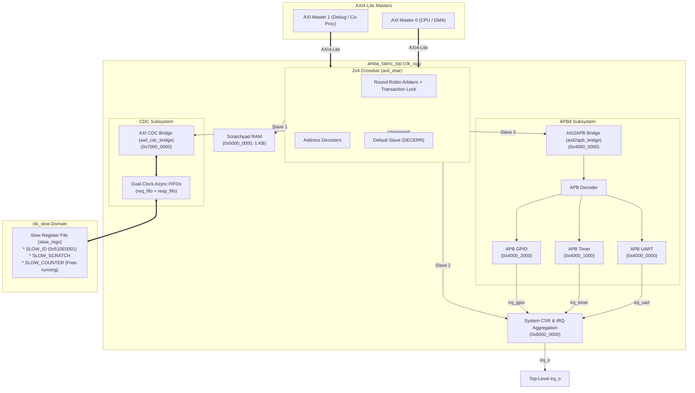
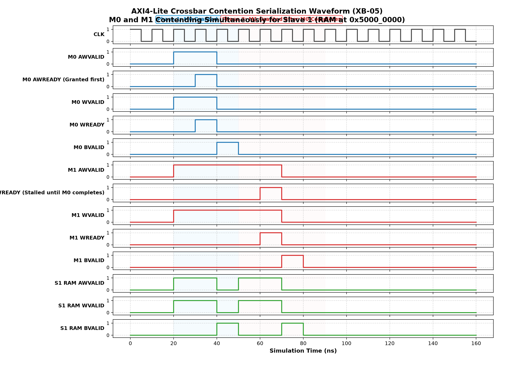

# AMBA AXI4-Lite / APB4 Fabric Subsystem & pyuvm Verification Environment

<!-- BEGIN:metrics:readme_badges -->
[](https://github.com/i-am-somasai/AMBA-AXI4-Lite-APB4-Fabric-Subsystem-pyuvm-Verification-Environment/actions/workflows/ci.yml)
[](.github/workflows/ci.yml)
[](LICENSE)
[](https://github.com/YosysHQ/oss-cad-suite-build)
[](https://github.com/google/skywater-pdk)
[](https://github.com/pyuvm/pyuvm)
[](docs/logs/func_cov.log)
[](docs/logs/formal_suite.log)
<!-- END:metrics:readme_badges -->

> **Methodology Note (Honest Labelling):** This verification environment is implemented using **pyuvm (UVM methodology in Python)** running on top of **cocotb**, **Icarus Verilog**, and **Verilator**, paired with **SymbiYosys (SBY)** formal property proofs and **Yosys** mutation testing. It adheres strictly to the UVM architecture (sequencers, drivers, monitors, agents, environments, reference models, and scoreboards), but is authored in Python/pyuvm rather than SystemVerilog class-based UVM.

---

## 1. Overview & Architectural Highlights

This project implements a complete, synthesizable system-on-chip interconnect fabric designed to AMBA AXI4-Lite and APB4 protocol specifications. The design features a multi-master crossbar, peripheral subsystem, cross-clock-domain bridging, and level interrupt aggregation:

- **2×4 AXI4-Lite Crossbar Interconnect (`axil_xbar`):**
  - Connects 2 independent AXI-Lite bus masters to 4 functional slaves plus an unmapped address space trap.
  - Per-slave inline registered round-robin arbiters (`wr_prio`/`rd_prio`; standalone `rr_arbiter` also verified) with **transaction lock** to prevent interleaving during multi-channel transfers.
  - Non-blocking concurrent transfers: simultaneous accesses to distinct slaves complete in parallel with **0 added serialization cycles**.
  - Default error termination slave (`axil_default_slave`) returning `DECERR` on unmapped transactions without bus hang.
- **AXI4-Lite Peripheral & Memory Slaves:**
  - **Scratchpad RAM (`axil_ram`):** 1 KB byte-addressable memory supporting all 16 `WSTRB` strobe patterns and out-of-range `SLVERR` response.
  - **System CSR (`axil_csr`):** System identification registers (`REV_ID` = `0xA3BA0001`, `VERSION` = `0x00010000`), byte-writable scratchpad, W1C status hooks, and interrupt masking/aggregation to `irq_o`.
- **AXI4-Lite to APB4 Bridge (`axil2apb_bridge`):**
  - Translates AXI4-Lite single-beat read/write transactions into APB4 `SETUP` $\rightarrow$ `ACCESS` phase transfers.
  - Supports configurable slave wait states (`PREADY`), byte strobes (`PSTRB`), protection pass-through (`PPROT`), and error mapping (`PSLVERR` $\rightarrow$ `SLVERR`).
- **APB4 Peripheral Subsystem:**
  - **APB UART (`apb_uart`):** 8N1 full-duplex UART with 8-entry TX/RX synchronous FIFOs, programmable baud rate divisor, loopback mode, framing error detection, and RX interrupt generation.
  - **APB Timer (`apb_timer`):** 32-bit decrementing timer supporting one-shot and periodic reload modes, deterministic timeout interrupts, and W1C status clear.
  - **APB GPIO (`apb_gpio`):** 16-bit general-purpose I/O with 2-FF input synchronizers, programmable direction, and rising-edge interrupt detection.
- **Clock Domain Crossing (CDC) Subsystem:**
  - Dual-clock asynchronous FIFO bridge (`axil_cdc_bridge`) with Cummings Gray-pointer synchronizers crossing from `clk_sys` to `clk_slow`.
  - Slow-domain register file (`slow_regs`) featuring a free-running 32-bit counter proving physical clock domain separation.
  - 2-FF reset synchronizers (`rst_sync`) for asynchronous assert and synchronous deassert across both clock domains.

---

## 2. Block Diagram



---

## 3. Subsystem Memory Map

| Slave Port | Peripheral / Block | Address Base | Address Range | Clock Domain | Description |
|---|---|---|---|---|---|
| **S0** | **APB4 Subsystem** | `0x4000_0000` | `0x4000_0000 - 0x4FFF_FFFF` | `clk_sys` | APB bridge and peripheral multiplexer |
| | *APB UART* | `0x4000_0000` | `0x4000_0000 - 0x4000_0010` | `clk_sys` | TX/RX data, status, baud divisor, loopback |
| | *APB Timer* | `0x4000_1000` | `0x4000_1000 - 0x4000_100C` | `clk_sys` | 32-bit counter, load value, control/status |
| | *APB GPIO* | `0x4000_2000` | `0x4000_2000 - 0x4000_2010` | `clk_sys` | Direction, output, input, interrupt enable |
| **S1** | **Scratchpad RAM** | `0x5000_0000` | `0x5000_0000 - 0x5000_03FF` | `clk_sys` | 1 KB byte-addressable scratchpad memory |
| **S2** | **System CSR** | `0x6000_0000` | `0x6000_0000 - 0x6000_0020` | `clk_sys` | Identification, scratchpads, IRQ aggregation |
| **S3** | **CDC Slow Regs** | `0x7000_0000` | `0x7000_0000 - 0x7000_000C` | `clk_slow` | Asynchronous CDC bridge to slow registers |
| **Default** | **Error Slave** | *All Other* | Unmapped address space | `clk_sys` | Returns `DECERR` on unmapped access |

---

## 4. Measured Verification & Implementation Results

Every number reported below is derived from an actual execution of open-source EDA tools. Raw terminal logs are archived under [`docs/logs/`](docs/logs/).

### 4.1 Master Deliverables & Metrics Table (Spec Section 17)

<!-- BEGIN:metrics:readme_metrics_table -->
| Metric | Measured Value | Spec Reference | Log Reference / Tool |
|---|---|---|---|
| **RTL Modules / Lines of RTL** | **17 modules / 3,200 lines** (non-blank, non-comment) | Section 17 | [`docs/metrics.json`](docs/metrics.json) |
| **Test Definitions / XML Runs / Spec Map** | **61 Python tests / 77 XML runs (77 PASS, 0 FAIL) / 40/40 Spec IDs** | Section 9 | [`docs/test_map.csv`](docs/test_map.csv), [`docs/vplan.md`](docs/vplan.md) |
| **Random Transactions Executed** | **200,000 transactions** (20 Verilator seeds `1..20` × 10,000 txns, 0 mismatches; plus 20 Icarus seeds `601..620` = 200,000 txns) | Section 9.1 (XB-13) | [`docs/logs/phase_c_cov_report.log`](docs/logs/phase_c_cov_report.log), [`docs/logs/regression_20seeds.log`](docs/logs/regression_20seeds.log) |
| **Functional Coverage (cocotb-coverage)** | **100.00% (267/267 reachable bins)** across 24 merged YAMLs; 36 waived illegal/contradictory bins | Section 10 | [`docs/logs/func_cov.log`](docs/logs/func_cov.log), [`docs/coverage_waivers.md`](docs/coverage_waivers.md) |
| **Code Coverage (Verilator)** | **Line 92.0% (494/537) \| Branch 91.2% (499/547) \| Expr 93.8% (1036/1105) \| Toggle 74.8% (10616/14202) \| FSM State 100.0% (5/5)** | Section 10 | [`docs/logs/code_cov_summary.txt`](docs/logs/code_cov_summary.txt) |
| **Formal Verification (SymbiYosys + Boolector)** | **10/10 suites PASS** (3 k-induction `prove`, 1 `prv+bmc`, 6 bounded `bmc`; 84 cover traces reached in 150s) | Section 11 | [`docs/logs/formal_suite.log`](docs/logs/formal_suite.log) |
| **CDC Clock Ratios & Phases Swept** | **3 slow periods (25.0 ns, 10.3 ns, 6.0 ns) × 3 phases**; formal `async_fifo` BMC depth 25 & `axil_cdc_bridge` BMC depth 30 | Section 9.1 (CD-01) | [`formal/async_fifo.sby`](formal/async_fifo.sby), [`docs/logs/func_cov.log`](docs/logs/func_cov.log) |
| **Mutation Testing (Yosys `mutate`)** | **Baseline 165/240 (68.75%) → Final 205/240 (85.42% raw)**, 0 timeouts, 0 build errors; **21 equivalent** (18 miter + 3 signal), **14 residual**, **93.61% (205/219) adjusted** | Section 12 | [`docs/logs/mutation.log`](docs/logs/mutation.log), [`docs/mutation_report.md`](docs/mutation_report.md) |
| **Bugs Found & Resolved** | **24 bugs (BUG-001–BUG-024)**: 15 RTL + 9 TB/formal/tooling | Section 6 | [`docs/bugs.md`](docs/bugs.md) |
| **Crossbar Added Latency (Cycles)** | **0 cycles added latency** (verified via XB-06 parallel transfer check) | Section 7.2 | [`docs/img/contention.png`](docs/img/contention.png), [`tb/block/test_axil_xbar.py`](tb/block/test_axil_xbar.py) |
| **Synthesis (SKY130 HD, `RAM_DEPTH=64`)** | **9,237 cells / 3,630 flops** (2,048 RAM flops) / **138,086.19 µm²** (74.78% sequential) | Section 13 | [`synth/synth.ys`](synth/synth.ys), [`docs/logs/synth.log`](docs/logs/synth.log) |
| **STA (OpenSTA): Target 100 MHz (10.0 ns)** | **VIOLATED: WNS -18.60 ns / TNS -54046.39 ns** (full timed netlist; pre-layout unbuffered `rst_sys_n`, fanout 958, slew 29.27 ns); **`clk_slow` MET (+16.64 ns)**, **Hold MET (+0.23 ns)**; datapath+I/O ref WNS -5.89 ns | Section 13 | [`docs/logs/sta.log`](docs/logs/sta.log), [`synth/amba_fabric.sdc`](synth/amba_fabric.sdc) |
| **STA (OpenSTA): Achieved $F_{\max}$** | **34.97 MHz (28.60 ns)** full pre-layout netlist; **62.89 MHz (15.90 ns)** datapath+I/O reference (`rst_sync` Q isolated in STA only) | Section 13 | [`docs/logs/fmax_sweep.log`](docs/logs/fmax_sweep.log) |
| **Continuous Integration Status** | **NOT VERIFIED** (Pending Phase G GitHub Actions push and remote verification) | Section 14 | [`.github/workflows/ci.yml`](.github/workflows/ci.yml) |
| **Out-of-Scope Items (`S-02/S-03`, `X-01/X-02`)** | **N/A (out of scope)**: gate-level sim (`S-02`), OpenLane GDSII (`S-03`), RISC-V CPU (`X-01`), multi-outstanding AXI4 (`X-02`) | Section 1.4 / 13.5 | [`docs/spec.md`](docs/spec.md) |
<!-- END:metrics:readme_metrics_table -->

---

## 5. Verification Methodology Details

### 5.1 pyuvm Environment Hierarchy
The testbench is structured strictly according to UVM guidelines in Python via `pyuvm`:
- **`AxilMasterAgent` (x2):** Encapsulates an `AxilMasterDriver`, `AxilMasterMonitor`, and sequencer driving concurrent, independent AXI-Lite channels (AW, W, B, AR, R) with randomized channel arrival skews (`aw_first`, `w_first`, `simultaneous`). Implemented as a genuine `pyuvm.uvm_agent`.
- **Slave Responders & Peripheral Behavioral Models:** The slave responders (`AxilSlaveResponder`, `ApbSlaveResponder`) and peripheral models (`UartModel`, `TimerModel`, `GpioModel`, `RamModel`, `RegModel`) are implemented as plain Python/cocotb coroutine and callback models integrated with the pyuvm environment and scoreboard.
- **`AxilProtocolMonitor`:** Passive checker monitoring bus signals on every clock edge, verifying AXI4-Lite stability rules (rule: once valid, address/data/valid must remain stable until ready).
- **`FabricScoreboard`:** Self-checking scoreboard embedding independent reference models:
  - `ram_model.py`: Byte-enable memory model with out-of-bounds error injection.
  - `reg_model.py`: Register model validating read-only, read-write, and W1C registers.
  - `addr_map.py`: Decode model verifying routing addresses independently from the RTL.
- **`CoverageCollector`:** Samples 9 distinct functional covergroups defined in [`tb/pyuvm/func_cov/fabric_cov.py`](tb/pyuvm/func_cov/fabric_cov.py) on every transaction.

### 5.2 Formal Verification (SymbiYosys + Boolector)
<!-- BEGIN:metrics:readme_formal_summary -->
All **10 SymbiYosys formal suites PASS** (`0` failures, **84 cover traces** reached across 150s total runtime, [`docs/logs/formal_suite.log`](docs/logs/formal_suite.log)):
- **Unbounded k-induction proofs (`prove`, depth 20):** `rr_arbiter` (`3` covers, including bounded fairness `f_wait_cnt < NUM_REQS`), `sync_fifo` (`8` covers, including `(* anyconst *)` magic-value data-ordering & integrity), and `apb_timer` (`4` covers), plus hybrid **`prv+bmc`** on `axil_csr` (`5` covers; `CHECK_CAUSALITY=1` in BMC, `0` in `prove` per `DEC-006`).
- **Bounded model checking (`bmc`):** `apb_uart` (depth `25`, `9` covers), `async_fifo` (multiclock depth `25`, `4` covers), `axil2apb_bridge` (depth `25`, `10` covers), `axil_cdc_bridge` (depth `30`, `5` covers), `axil_ram` (depth `20`, `5` covers), and `axil_xbar` (depth `20`, `31` covers, including `wr_prio`/`rd_prio` bounded fairness).
- **Scope note (`DEC-007`):** `rr_arbiter` is a standalone formally verified and unit-tested library block and is not instantiated inside `axil_xbar` (which uses inline registered round-robin arbiters).
<!-- END:metrics:readme_formal_summary -->

### 5.3 Mutation Testing & Survivor Triage (Yosys Native)
<!-- BEGIN:metrics:readme_mutation_summary -->
Evaluated on a frozen deterministic 240-mutant suite (`30` mutants per module across `8` RTL modules, seed `42`, [`mutation/mutant_list_240.json`](mutation/mutant_list_240.json)) using isolated process-group execution (`mutation/run_mutants.py`) and strict `$paramod*axil_xbar` module scoping ([`docs/mutation_report.md`](docs/mutation_report.md)):
- **D3 Baseline (before gap tests):** `165/240` killed (**`68.75%` raw**), `64` survived, `11` timeouts, `0` build errors.
- **D5 Final (same 240-mutant list):** **`205/240` killed (`85.42%` raw)**, **`0` timeouts**, **`0` build errors**.
- **Formal Equivalence & Adjusted Score:** Of `35` survivors, **`21` are proven equivalent** (`18` by Yosys `equiv_induct` / Boolector depth-10 miters in [`docs/logs/mutation_equiv.log`](docs/logs/mutation_equiv.log) + `3` signal-level proofs on `axil_default_slave._unused_inputs`), leaving **`14` residual non-equivalent survivors** and **`93.61%` (`205/219`) adjusted mutation score**.
<!-- END:metrics:readme_mutation_summary -->

### 5.4 Synthesis and STA (SKY130 High Density)
<!-- BEGIN:metrics:readme_synth_sta_summary -->
Synthesized for SKY130 HD (`tt_025C_1v80`, `RAM_DEPTH=64` = `2,048` RAM flops) using Yosys [`synth/synth.ys`](synth/synth.ys) and analyzed with OpenSTA [`synth/sta.tcl`](synth/sta.tcl) and [`synth/fmax_sweep.py`](synth/fmax_sweep.py):
- **Area & Cells:** **`9,237` cells**, **`3,630` flip-flops** (`1,140` `dfrtp_1` + `10` `dfstp_1` + `2,480` `edfxtp_1`), **`138,086.19 µm²`** (`74.78%` sequential; [`docs/logs/synth.log`](docs/logs/synth.log)).
- **CDC / Gray-Pointer STA Constraints (Spec Section 13.2):** [`synth/amba_fabric.sdc`](synth/amba_fabric.sdc) declares `clk_sys` (`10.0 ns` / `100 MHz`) and `clk_slow` (`24.0 ns` / `41.67 MHz`) in `set_clock_groups -asynchronous`, avoiding brittle cell-level `set_max_delay` paths across the Cummings Gray-pointer synchronizer chains (`sync_w2r_q1/q2`, `sync_r2w_q1/q2`), while relying on single-bit Gray-code transitions verified by formal multiclock BMC. External `rst_n` false-pathing targets **only** `rst_n -> rst_sync`; `rst_sys_n`/`rst_slow_n` recovery & removal paths stay timed (`DEC-011`).
- **100 MHz Target (`10.0 ns`) Result — `VIOLATED`:** Full pre-layout netlist **WNS = `-18.60 ns`**, **TNS = `-54046.39 ns`**, achieved $F_{\max}$ = **`34.97 MHz` (`28.60 ns`)** because pre-layout synthesis leaves `rst_sys_n` unbuffered (`fanout=958`, `cap=3.46 pF`, `slew=29.27 ns`). Secondary clock `clk_slow` (`41.67 MHz`) **MET** with **`+16.64 ns`** slack, and hold **MET** (`+0.23 ns`). Isolating `rst_sync` Q in STA as a pre-CTS core+I/O reference yields datapath+I/O **WNS = `-5.89 ns`** (**`62.89 MHz`** at `15.90 ns`; pure reg-to-reg slack `-4.15 ns`), with physical CTS/reset-tree closure (`S-03` OpenLane) out of scope.
<!-- END:metrics:readme_synth_sta_summary -->

---

## 6. Key Bugs Found & Resolved Showcase

<!-- BEGIN:metrics:readme_bugs_summary -->
All **24 discovered bugs (`BUG-001`–`BUG-024`)** (15 RTL defects + 9 testbench/formal/tooling defects) are documented with root cause and verified regression references in [`docs/bugs.md`](docs/bugs.md) (enforced by [`scripts/check_bug_refs.py`](scripts/check_bug_refs.py)). Three representative fixes:
<!-- END:metrics:readme_bugs_summary -->

1. **`BUG-005` — APB Bridge Premature Access Completion on Zero Wait States:**
   - *Detection Method:* Directed Test `BR-01` & Waveform Inspection.
   - *Root Cause:* In `ST_ACCESS`, `m_apb_penable <= 1'b1; if (m_apb_pready)` was evaluated on the first cycle of `ST_ACCESS` when `penable` was still low from `ST_SETUP`. Because `pready` was already high (zero wait states), the bridge completed immediately without ever asserting `PENABLE` on the bus.
   - *Fix:* Qualified completion with `if (m_apb_penable && m_apb_pready)`.
2. **`BUG-008` — Master Driver Staggered W-First Transaction Hang on Crossbar:**
   - *Detection Method:* Block Test execution (`test_xb08_write_orderings`).
   - *Root Cause:* On an unbuffered crossbar, write data (`W`) cannot be routed to the addressed slave until the write address (`AW`) is decoded. The driver held `AWVALID=0` waiting for `WREADY=1`, causing a mutual wait state.
   - *Fix:* Driver updated to assert `WVALID=1`, wait 2 clock cycles stagger, and assert `AWVALID=1` without waiting for `WREADY`.
3. **`BUG-020` — APB Bridge Test Stimulus Self-Comparison Masking Write Data Bit-Corruption:**
   - *Detection Method:* Yosys Mutation Testing (`axil2apb_bridge_mut_0.v`).
   - *Root Cause:* The testbench compared readback data against slave memory (`apb_slave.memory.get(offset)`), which had already captured the corrupted data from `pwdata`. Comparing corrupted output to corrupted slave state passed silently.
   - *Fix:* Added direct comparison against golden test vectors and tested complementary bit patterns where bit 29=1.

---

## 7. Waveform Showcase

### Contention & Round-Robin Arbitration Waveform
Waveform capture showing sustained contention on Slave 1 (RAM) where Master 0 and Master 1 compete simultaneously, demonstrating round-robin alternation and transaction lock:



*Waveform plot rendered via [`scripts/render_waveform.py`](scripts/render_waveform.py) from simulation trace (`*.vcd` artifacts are gitignored).*

---

## 8. Quick Start Guide (One-Command Reproduction)

### 8.1 Prerequisites & Toolchain Setup
The project uses the **open-source toolchain** (no commercial EDA licenses required):
- `iverilog` (v14.0+), `verilator` (v5.020+), `yosys` (v0.70+), `sby`, `sta` (v2.6+).
- Python 3.11 with `cocotb 2.1.0`, `pyuvm 5.0.0`, `cocotb-coverage 2.0`.
- SKY130 HD PDK library file (via Volare / OpenLane).

```bash
# 1. Source environment variables
source scripts/env.sh

# 2. Verify toolchain availability
make env-check
```

### 8.2 Running Verification Targets

```bash
# Run RTL lint across all modules (Verilator)
make lint

# Run L0 unit tests on Icarus Verilog
make unit SIM=icarus

# Run L1 block and subsystem tests
make block SIM=icarus

# Run full pyuvm multi-seed regression (XB-13 stress, 20 seeds, 200,000 txns)
make regress SIM=icarus SEEDS=20

# Run Verilator code coverage and merge functional coverage
make cov-report

# Run all 10 SymbiYosys formal proof suites
make formal

# Run full mutation testing across 240 mutants
make mutation

# Run full Yosys synthesis for SKY130 HD
make synth

# Run OpenSTA static timing analysis and Fmax sweep
make sta
```

---

## 9. Resume Bullets (Measured Numbers)

<!-- BEGIN:metrics:readme_resume_bullets -->
**Title line:** *AMBA AXI4-Lite/APB Fabric with pyuvm Verification Environment | Verilog-2005 (SystemVerilog-compatible RTL), Python, cocotb, pyuvm, SymbiYosys, Yosys, OpenSTA*

- Designed and verified a **17-module (3,200 non-blank/non-comment lines)** AXI4-Lite `2×4` crossbar + APB4 peripheral subsystem (`UART`, `Timer`, `GPIO`), `RAM`, `CSR`, and Gray-pointer CDC bridge targeting dual clock domains (`100 MHz` / `41.67 MHz`).
- Built a **pyuvm/cocotb** verification environment (**61 tests**, **40/40** Spec 9.1 tests passing, **77** XML testcases passing) running **200,000** Verilator stress transactions (20 seeds) plus **200,000** Icarus transactions (20 seeds) with **0 scoreboard mismatches**.
- Closed honest functional coverage to **100.00% (267/267 reachable bins)** across 24 merged YAMLs (`36` waived bins documented) and measured Verilator code coverage of **92.0% line**, **91.2% branch**, and **93.8% expression**.
- Proved **10/10** SymbiYosys formal suites (`3` unbounded k-induction `prove` + `1` `prv+bmc` + `6` bounded `bmc`, **84 cover traces**); improved frozen 240-mutant testing from **68.75% (165/240)** baseline to **85.42% raw (205/240)** and **93.61% adjusted (205/219)** after Yosys/Boolector equivalence checking.
- Synthesized for SKY130 HD via Yosys (`RAM_DEPTH=64`: **9,237 cells**, **3,630 flops**, **138,086.19 µm²**) and ran reproducible OpenSTA sweeps (**WNS -18.60 ns** / **34.97 MHz** full netlist limited by unbuffered `rst_sys_n`; **62.89 MHz** core+I/O reference; `clk_slow` and hold met), logging **24 bugs** across RTL and verification.
<!-- END:metrics:readme_resume_bullets -->

---

## 10. Repository Organization

```
amba-fabric/
├── README.md                      # Project overview, architecture, results, and quick-start guide
├── Makefile                       # Top-level unified Makefile (lint, unit, regress, formal, synth, sta)
├── requirements.txt               # Pinned Python dependencies (cocotb, pyuvm, cocotb-coverage)
├── .github/workflows/ci.yml       # GitHub Actions CI workflow (lint, unit, regression, formal, mutation)
├── docs/
│   ├── spec.md                    # Authoritative design and verification specification
│   ├── interfaces.md              # Frozen architectural interface contract
│   ├── vplan.md                   # Verification plan: feature -> test -> coverage -> check mapping
│   ├── results.md                 # Real, measured verification, coverage, formal, and PPA metrics
│   ├── bugs.md                    # Bug tracking log (`BUG-001`..`BUG-024`)
│   ├── checkpoint.md              # Phase-by-phase iteration checkpoint log
│   ├── decisions.md               # Architectural decision record
│   ├── logs/                      # Raw log archives (formal, coverage, synthesis, sta, mutation)
│   └── img/                       # Waveform screenshots and diagrams (contention.png)
├── rtl/
│   ├── common/                    # rst_sync.v, sync_fifo.v, async_fifo.v, rr_arbiter.v
│   ├── axil/                      # axil_decoder.v, axil_xbar.v, axil_ram.v, axil_csr.v, axil_default_slave.v
│   ├── apb/                       # axil2apb_bridge.v, apb_decoder.v, apb_uart.v, apb_timer.v, apb_gpio.v
│   ├── cdc/                       # axil_cdc_bridge.v, slow_regs.v
│   └── amba_fabric_top.v          # Top-level SoC fabric integration wrapper
├── tb/
│   ├── unit/                      # L0 cocotb unit tests for all common and leaf blocks
│   ├── block/                     # L1 block tests for crossbar, bridge, peripherals, and CDC
│   ├── pyuvm/                     # L2 subsystem pyuvm verification environment
│   │   ├── agents/                # axil_master, axil_slave, apb_responder, uart, gpio, clk_rst
│   │   ├── env/                   # FabricEnv, FabricScoreboard, AxilProtocolMonitor
│   │   ├── func_cov/              # cocotb-coverage covergroup definitions (fabric_cov.py)
│   │   ├── sequences/             # Directed and constrained-random sequences
│   │   └── tests/                 # Directed (test_directed.py) and stress (test_stress.py) tests
│   └── models/                    # Independent Python reference models (ram, reg, addr_map, driver)
├── formal/                        # SymbiYosys formal verification suites (*.sby, *_props.v)
├── mutation/                      # Mutation testing framework (run_mutants.py, survivor reports)
├── synth/                         # Yosys synthesis (synth.ys) and OpenSTA timing (sta.tcl, fmax_sweep.py)
└── scripts/                       # Environment wrapper (env.sh), regression and coverage merging scripts
```
